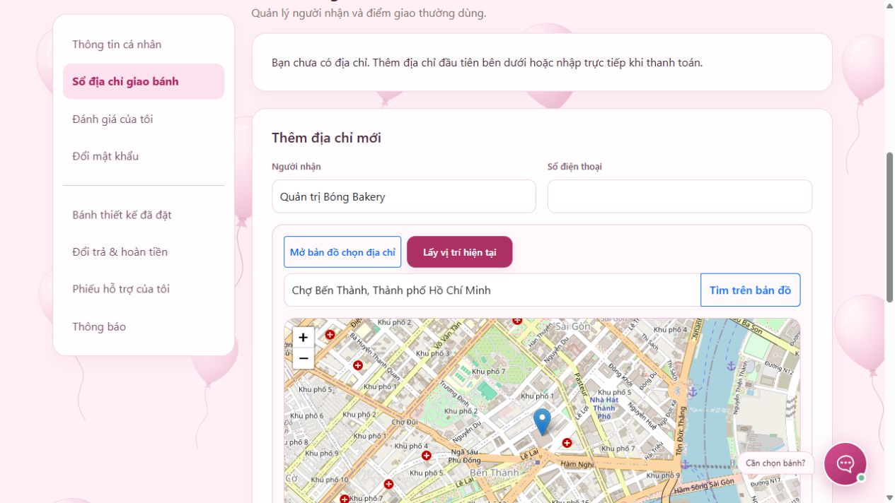

# Kết quả kiểm thử ngày 28/10/2026

## Kết quả cuối cùng

| Nhóm | Kết quả |
|---|---|
| Java/Spring | **87 đạt**, 0 thất bại, 0 lỗi, 0 bỏ qua |
| JavaScript | **24 đạt**, 0 thất bại, 0 bỏ qua |
| SQL Server thật | Khởi động ứng dụng với Windows Authentication và kiểm tra cấu trúc Hibernate thành công |
| File SQL tổng | Chạy thành công từ đầu trên database thử riêng; 24 bảng, 13 danh mục, 39 bánh có ảnh, mỗi danh mục 3 bánh; DBCC CHECKCONSTRAINTS không báo lỗi |

Tổng cộng **111 kiểm thử tự động đạt**. File SQL được chạy trên database tên ngẫu nhiên dành riêng cho lượt thử, sau đó đã xóa database thử. Không chạy file khởi tạo trên `cake_shop` đang dùng.

## Phạm vi đã kiểm tra

- Tồn kho: thêm vượt tồn sẽ giữ mức tối đa và cảnh báo sau chuyển trang; nhiều lựa chọn cùng dùng một tồn sản phẩm; giảm tồn tự điều chỉnh giỏ; hết hàng bỏ khỏi giỏ; hai khách cùng mua chiếc cuối chỉ một giao dịch thành công. Không trừ tồn chỉ vì thêm giỏ.
- Phân trang: có nút số, giữ các bộ lọc; trang vượt giới hạn chuyển về trang cuối; danh sách dài có dấu … và trang đầu/cuối.
- Hồ sơ: cập nhật tên/điện thoại, kiểm tra dữ liệu, không thay email/quyền từ dữ liệu gửi thêm; xem đánh giá của riêng mình, bao gồm nội dung bị ẩn và lý do ẩn.
- Địa chỉ: thêm/sửa/xóa theo chủ tài khoản, chặn sửa/xóa của người khác; đường dẫn cũ chuyển về sổ địa chỉ mới, lưu từ checkout quay về checkout; tọa độ được lưu vào bản chụp đơn và từ chối tọa độ không hợp lệ.
- Mật khẩu: bắt buộc mật khẩu hiện tại, mật khẩu mới và xác nhận; đổi thành công kết thúc đăng nhập cũ và vô hiệu mã quên mật khẩu chưa dùng; đăng nhập mật khẩu cũ thất bại, mật khẩu mới thành công. Kiểm thử dùng tài khoản tạm trên H2, không đổi mật khẩu tài khoản cửa hàng thật.
- Shipper: màn hình tạo/sửa/danh sách, quyền truy cập, phân công đúng trạng thái, chặn ngừng shipper còn đơn, chỉ shipper phụ trách mới bắt đầu giao được.
- GPS: yêu cầu CSRF/phiên chia sẻ, chủ đơn và shipper đúng quyền mới xem được; từ chối tọa độ ngoài phạm vi/GPS quá cũ; cảnh báo vị trí không cập nhật; dừng/đổi shipper làm bản tin đến trễ không còn hợp lệ; báo bàn giao xóa tọa độ và không tự tạo khoản thanh toán.
- JavaScript: giới hạn số lượng, xác nhận xóa địa chỉ, đối chiếu mật khẩu mới, GPS chỉ gửi sau khi bật, gửi kèm CSRF/phiên, dừng không gửi tiếp, ẩn trang dừng GPS, phản hồi mở phiên đến trễ không khởi động lại GPS, lỗi quyền vị trí/mạng và cảnh báo ghim cũ.
- Hồi quy các phần trước: giỏ/đặt hàng/voucher, thanh toán cọc, hóa đơn/PDF, đổi trả/hoàn tiền, đánh giá có ảnh, yêu thích, Excel, trợ lý/hỗ trợ, báo cáo và nguồn ảnh. Kiểm thử tranh chấp tồn cuối, lượt voucher cuối, gửi trùng đánh giá và hoàn tiền đồng thời đều đạt.

## Kiểm tra trình duyệt với SQL Server

Ứng dụng kiểm tra chạy cổng 8081 riêng, không dừng ứng dụng người dùng ở cổng 8080. Đã đăng nhập quản trị để xem trang cá nhân và sổ địa chỉ; mở bản đồ, tìm địa điểm công cộng Chợ Bến Thành và chọn kết quả: bản đồ đặt ghim, ô địa chỉ tự điền đúng kết quả. Không lưu địa chỉ công cộng thử vào sổ địa chỉ thật.

Ở trang chi tiết bánh còn 12, nhập 99 khiến ô về 12 và hiện cảnh báo. Thêm vào giỏ riêng của phiên kiểm tra được 12, mở thanh toán và bật địa chỉ mới thấy các ô người nhận/điện thoại/bản đồ. Không nhấn xác nhận đặt hàng trên SQL Server thật. Đã bấm nút Trang 2 trên bộ sưu tập và xác nhận hiện Trang 2 / 4 cùng liên kết Trước/Sau.

## Điều chỉnh khi chạy kiểm thử

Lượt đầu phát hiện các kịch bản hồi quy cũ chưa có bước phân công shipper trước khi chuyển sang đang giao, và còn yêu cầu trang địa chỉ cũ trả nội dung thay vì chuyển đến trang cá nhân. Đã cập nhật dữ liệu và bước chuẩn bị của kiểm thử theo quy trình mới; giữ nguyên quy tắc phân quyền/shipper của ứng dụng. Bổ sung 14 kiểm thử Java và 9 kiểm thử JavaScript cho chức năng mới. Một xác nhận thông báo được sửa để đọc cảnh báo thật được giữ trong phiên khi chuyển trang, thay vì chèn thông báo giả khác.

## Giới hạn

Các thao tác tạo đơn, đổi mật khẩu, phân công, gửi tọa độ và hoàn tiền dùng H2 chế độ SQL Server/MockMvc và mô phỏng JavaScript. **Chưa kiểm tra hành trình GPS thật trên điện thoại, theo dõi qua mạng di động hoặc khi khóa màn hình.** Không cấp quyền lấy vị trí thật của thiết bị trong lượt kiểm tra. Đã kiểm tra tìm địa chỉ công cộng qua dịch vụ Photon và tải nền OpenStreetMap trên trình duyệt.

SMTP hiện cấu hình sau nên không gửi email thật; thư khôi phục được thử bằng đối tượng giả lập. Chưa kiểm tra tất cả kích thước màn hình hoặc tải lớn. Kết quả này không thay thế nghiệm thu vận hành/bảo mật đầy đủ.

Log cục bộ: `target/kiem-thu-2026-10-28.log`, `target/surefire-reports/`, `target/kiem-thu-js-2026-10-28.log`, `target/kiem-thu-sql-20261028.log`, `target/kiem-thu-file-sql-tong.log`, `target/kiem-thu-file-sql-tong-check.log`.
