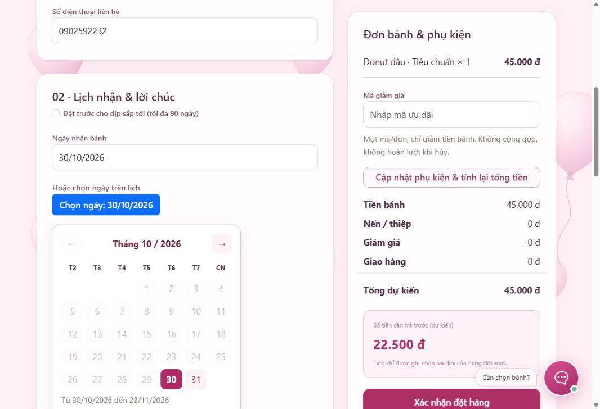
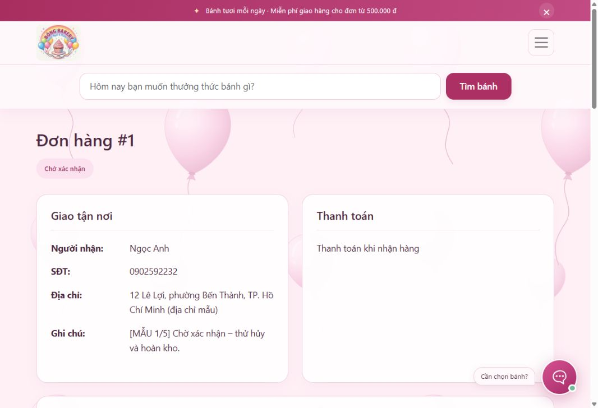
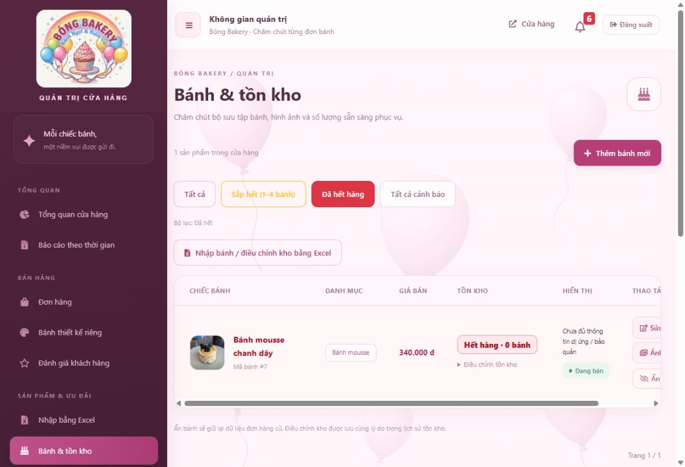

# Kết quả kiểm thử Bóng Bakery – 29/10/2026

## Kết quả cuối

- **104/104 kiểm thử Java/Spring đạt**: 103 ca tích hợp và 1 ca khởi động ứng dụng.
- **24/24 kiểm thử JavaScript đạt**, gồm kiểm tra cú pháp toàn bộ JavaScript giao diện.
- **17/17 tình huống HTTP đạt trên website chạy với SQL Server SPQR**, không dùng database H2 cho các tình huống này.
- Sau phần chống dọn giỏ lặp trong controller, chạy lại 5 ca liên quan đăng nhập/checkout/gộp giỏ: **5/5 đạt**. Không cộng các ca chạy lại vào tổng 145 tình huống khác nhau ở trên.
- SQL tổng chạy thành công để tạo bộ mẫu, Hibernate kiểm tra cấu trúc và website khởi động thành công trên cổng 8080.

Lượt đầu có 5 ca thất bại: một lỗi chưa xóa saved request cũ sau đăng nhập, hai kỳ vọng cũ về bấm hủy lặp, một kiểm tra giỏ theo session cũ và một kiểm tra thông tin liên hệ cũ. Đã sửa lỗi đăng nhập, cập nhật các ca theo yêu cầu mới, sau đó toàn bộ bộ kiểm thử đạt. Không bỏ qua ca kiểm thử nào.

## Phạm vi tự động

Đặt hàng/giá/voucher/tồn kho và tranh mua hàng cuối; phân quyền; hủy và hoàn kho; nhận quầy/cọc/QR; bánh riêng/chốt/duyệt mẫu; đổi trả/duyệt/từ chối/hoàn; đánh giá; hồ sơ/yêu thích/quên mật khẩu; báo cáo PDF/Excel; bản đồ/shipper; giỏ tài khoản/gộp khách/khác phiên/không lộ giỏ; địa chỉ mặc định và nhớ phương thức, khung giờ.

## 17 tình huống HTTP với SQL Server thật

1. Admin đăng nhập và về trang chủ.
2. Checkout hiển thị ngày Việt Nam, gợi ý nhận quầy từ lần gần nhất.
3. Chi tiết đơn có khung giao nhận, bánh/phụ kiện và tổng tiền.
4. Sổ địa chỉ hiển thị mặc định.
5. QR nhận quầy trả PNG và tải dưới dạng attachment.
6. URL stock=out có dấu phẩy vẫn dùng được, hàng hết có lớp màu đỏ.
7. Khách khác không đọc được đơn không thuộc mình.
8. Giỏ tài khoản tải trên hai phiên HTTP độc lập.
9. Giỏ khách gộp đúng số lượng vào giỏ đã lưu.
10. Đặt đơn chuyển khoản với ngày dd/mm/yyyy trên SQL Server.
11. Đặt thành công loại đúng lượng đã mua khỏi giỏ.
12. Gợi ý lại khung giờ 18:00–20:00 sau khi đặt.
13. Hủy đơn đã ghi nhận thu đưa vào hàng chờ hoàn.
14. Thiếu xác nhận đã hoàn thực tế bị chặn, vẫn chờ hoàn.
15. Ghi nhận hoàn đủ có thông tin đối soát thì rời hàng chờ.
16. Gửi lại cùng mã không hoàn hai lần; khách thấy hoàn đủ.
17. Shipper đăng nhập thấy đúng đơn đã phân công.

Các khoản thu/hoàn trong kiểm thử đều là bản ghi **DEMO** trên database đồ án. Không gọi API chuyển tiền ngân hàng hay Stripe Refund; chưa thực hiện giao dịch thẻ thử từ đầu đến cuối với Stripe Checkout bên ngoài.

## Kiểm tra giao diện

- Lịch mới mở ra Tháng 10 / 2026, T2–CN, chỉ cho chọn ngày trong khoảng hợp lệ. Chọn 31/10 cập nhật ô thành **31/10/2026**, lịch đóng lại. Không còn ô native type=date phụ thuộc định dạng hệ điều hành ở checkout/bánh riêng.
- Đơn #1 có các khung nền trắng và nhãn rõ; bảng bánh và tổng tiền có khung riêng.
- Địa chỉ mặc định hiển thị đúng và có ô chọn/nút đặt mặc định.
- Trang hết hàng hiển thị nhãn **Hết hàng · 0 bánh** màu đỏ; bảng nền đỏ nhẹ.
- Trang Hoàn tiền sau hủy mở được; các điều kiện bắt buộc đã kiểm tra thêm bằng HTTP.

Ảnh xác nhận:

## Dữ liệu bàn giao

Đã sao lưu database cũ tại:
`C:\Program Files\Microsoft SQL Server\MSSQL16.SPQR\MSSQL\Backup\BongBakery_truoc_bo_mau_20261029.bak`.

Sau kiểm thử, dừng website tạm, chạy lại SQL tổng để xóa các dữ liệu phát sinh và giữ bộ mẫu sạch. Kiểm tra cuối:

| Dữ liệu | Số lượng |
|---|---:|
| Bảng | 26 |
| Tài khoản | 5 |
| Bánh | 39 |
| Đơn mẫu | 5 |
| Bánh riêng | 2 |
| Dòng giỏ theo tài khoản | 2 |
| Địa chỉ mặc định | 2 |
| Giao dịch DEMO-HTTP còn sót | 0 |

Tài khoản mẫu và cách thao tác: [Bộ mẫu](DU-LIEU-MAU-VA-TINH-HUONG.md). Chi tiết cơ chế mới: [Giỏ tài khoản và hoàn tiền](GIO-TAI-KHOAN-VA-HOAN-TIEN.md).
