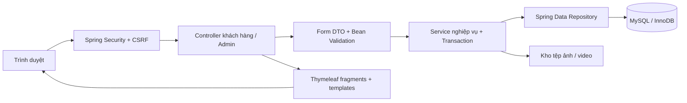
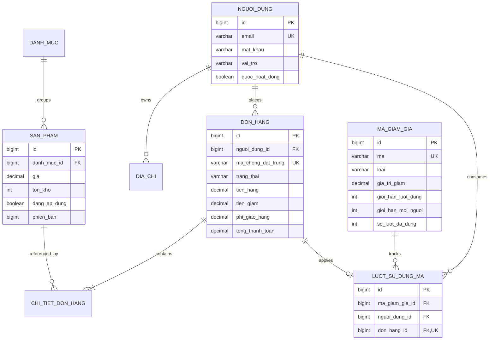
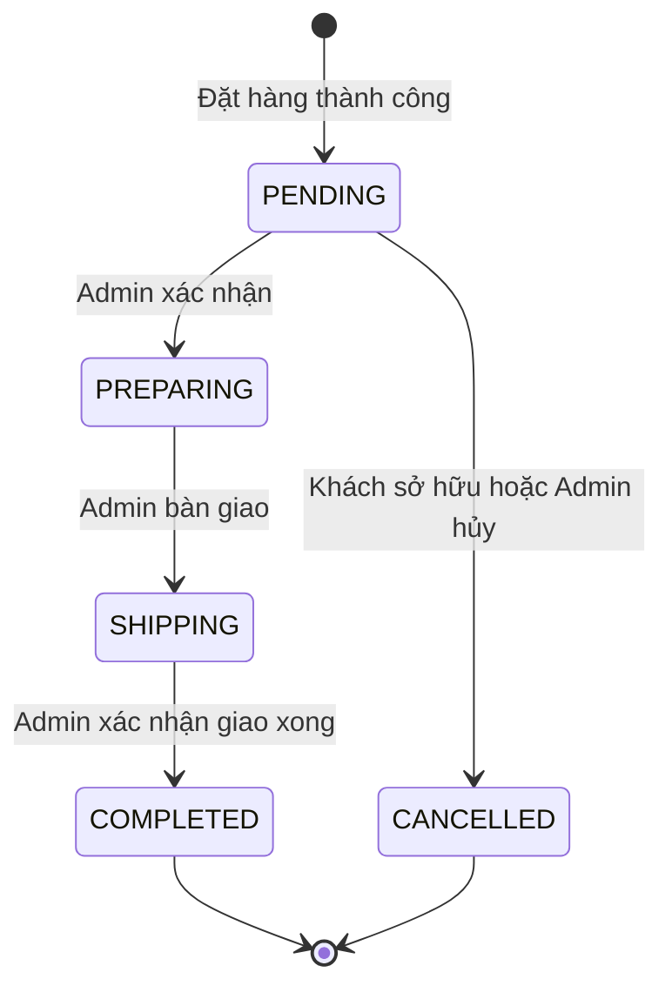

# Thiết kế và kế hoạch xây dựng Bóng Bakery

> Cập nhật 25/10/2026: theo môi trường thực tế của người dùng, hệ quản trị đang sử dụng là **Microsoft SQL Server** với Windows Authentication. Dùng `database/01-tao-day-du-sql-server.sql` và hướng dẫn `docs/CHAY-SQL-SERVER.md`. Các phần nhắc MySQL bên dưới ghi lại thiết kế ban đầu; bảng nghiệp vụ và quy tắc mua hàng giữ nguyên, kiểu chữ đã chuyển sang NVARCHAR tương ứng.

## 1. Mục tiêu và phạm vi

Xây dựng website bán bánh với luồng mua hàng hoàn chỉnh từ khám phá sản phẩm đến theo dõi đơn. Hai vai trò chính: khách hàng USER và người vận hành ADMIN; khách chưa đăng nhập được xem bánh và dùng giỏ hàng, nhưng phải đăng nhập để đặt đơn. Phần thiết kế bổ sung của đồ án là **mã giảm giá có kiểm soát điều kiện và giới hạn sử dụng**, liên kết tài khoản, giỏ hàng, đơn hàng và quản trị.

Tài liệu TH4 đính kèm được dùng như tiêu chí tham khảo cho hiện vật thiết kế: mô tả nhu cầu, luồng xử lý, bảng quy tắc, dữ liệu và bản phác thảo giao diện. Đợt cập nhật 25/10/2026 đã đối chiếu thêm 5 nhóm theo yêu cầu mới trong `DOI-CHIEU-5-YEU-CAU.md`; đã bổ sung đổi trả, hội thoại truy xuất theo quy tắc và phiếu hỗ trợ. Chưa kết nối AI tạo sinh/LLM; không xem trợ lý hiện tại là mô hình AI.

## 2. Kiến trúc MVC

Controller nhận request/DTO và chọn view; Service kiểm tra nghiệp vụ; Repository truy vấn và khóa bản ghi; Entity ánh xạ bảng. Mật khẩu BCrypt, phân quyền `/admin/**`, CSRF trên POST, kiểm tra quyền sở hữu đơn và địa chỉ. Không nhận giá, vai_tro hay chủ đơn từ form khách hàng. Không đặt nghiệp vụ tính tiền trong JavaScript.

## 3. Cơ sở dữ liệu trước khi triển khai chức năng

### Quan hệ chính

### Các bảng và Entity

| Bảng / Entity | Dữ liệu và trách nhiệm |
|---|---|
| `nguoi_dung` / `User` | Họ tên, email unique, mat_khau hash, vai_tro USER/ADMIN, enabled. Không lưu mật khẩu rõ. |
| `danh_muc` / `Category` | Tên danh mục unique, mô tả. Chỉ xóa khi không còn sản phẩm tham chiếu. |
| `san_pham` / `Product` | Tên, mô tả, giá VND DECIMAL(14,0), tồn khả dụng, FK category, URL ảnh/video, noi_bat, dang_ap_dung, version. Ẩn thay vì xóa lịch sử. |
| `dia_chi` / `Address` | FK user, người nhận, số điện thoại, địa chỉ đầy đủ. Thanh toán chỉ chấp nhận địa chỉ của chính người mua. |
| `don_hang` / `CustomerOrder` | FK user; bản chụp dữ liệu địa chỉ, tiền và ma_uu_dai; phuong_thuc_thanh_toan; trang_thai; thời điểm tạo; token unique. Không trỏ trực tiếp địa chỉ để tránh thay đổi lịch sử. |
| `chi_tiet_don_hang` / `OrderItem` | FK order/product, bản chụp dữ liệu tên và đơn giá, số lượng 1–99. Không dùng giá hiện tại để hiển thị đơn cũ. |
| `ma_giam_gia` / `Voucher` | Mã, loại PERCENT/FIXED, giá trị, đơn tối thiểu, giảm tối đa, khoảng hiệu lực, tổng giới hạn, giới hạn mỗi user, số lượt đã dùng, active. |
| `luot_su_dung_ma` / `VoucherUsage` | FK voucher/user/order. `don_hang_id` unique đảm bảo một mã giảm giá mỗi đơn; giữ cả đơn bị hủy theo chính sách không hoàn lượt. |

Mỗi Entity có Repository tương ứng. `ProductRepository` hỗ trợ Specification để kết hợp bộ lọc và Pageable. Product/Voucher/User/Order có truy vấn `PESSIMISTIC_WRITE` cho các thao tác cạnh tranh. Index: sản phẩm `(dang_ap_dung, danh_muc_id, gia)`, đơn `(nguoi_dung_id,ngay_tao)` và `(trang_thai,ngay_tao)`, lượt dùng `(ma_giam_gia_id,nguoi_dung_id)`.

Giỏ hàng lưu session dạng `productId → so_luong`, không cần bảng cart trong MVP. Tổng tiền được tính lại từ giá đang bán khi đặt hàng. Khi mở rộng có thể thêm `carts/cart_items` để dùng xuyên thiết bị.

## 4. Thứ tự ưu tiên và tiêu chí hoàn thành

| Giai đoạn | Công việc | Phụ thuộc | Điều kiện hoàn thành |
|---|---|---|---|
| P0 — thiết kế | ERD, schema/seed, mã giảm giá, trạng thái đơn, cấu trúc MVC | Không | Bảng/quan hệ/ràng buộc và quy tắc được đặc tả |
| P1 — nền tảng | Boot 3, Maven, Entity/Repository, MySQL, Security USER/ADMIN | P0 | Khởi động bằng cấu trúc bảng; đăng ký/login; USER không vào Quản trị |
| P2 — cửa hàng | Fragment header/footer, trang chủ, danh mục, lọc, chi tiết, phân trang | P1 | Sản phẩm mẫu hiển thị; bộ lọc và trang rỗng hoạt động |
| P3 — mua hàng | Session cart, địa chỉ, thanh toán COD/chuyển khoản, bản chụp dữ liệu giá, khóa kho | P2 | Một thanh toán thành công tạo order/items và trừ kho nguyên tử |
| P4 — mã giảm giá | Xem trước, điều kiện, giới hạn, khóa mã, lịch sử sử dụng | P3 | Không vượt tổng lượt/per-user; mã lỗi không trừ kho |
| P5 — sau mua | Lịch sử/chi tiết, quyền sở hữu, hủy pending, hoàn kho một lần | P3/P4 | Không xem/hủy đơn người khác; trạng thái hợp lệ |
| P6 — quản trị | CRUD danh mục/sản phẩm/voucher, media, kho, đơn, user, bảng tổng quan | P1–P5 | ADMIN thao tác đầy đủ, tải lên được giới hạn |
| P7 — nghiệm thu | Integration test, MySQL thật, tương thích nhiều kích thước màn hình, README Eclipse | P1–P6 | Test chạy qua; danh sách kiểm tra trình duyệt và MySQL được ghi nhận |

Các phần P0–P6 có mã nguồn/hiện vật trong repository. P7 gồm kiểm thử tự động và các bước nghiệm thu thực tế được phân biệt trong `KIEM-THU.md`; không coi kết quả H2 là bằng chứng MySQL đã chạy.

## 5. Luồng đặt hàng và tồn kho

1. Khách thêm sản phẩm đang bán vào giỏ, giới hạn 99 bánh/mặt hàng và 50 mặt hàng/giỏ.
2. Đăng nhập, chọn địa chỉ đã lưu, phương thức thanh toán và mã giảm giá nếu có.
3. Xem trước giảm giá; chưa tiêu thụ mã giảm giá và chưa giữ kho.
4. Server kiểm tra CSRF/session token; khóa user; tìm lại đơn có token để tránh tạo lặp.
5. Khóa sản phẩm theo ID tăng dần; kiểm tra active/tồn, lấy giá hiện tại và trừ kho.
6. Khóa mã giảm giá, kiểm tra lại hiệu lực/lượt dùng, tính tiền; ghi order/items/usage trong cùng transaction.
7. Thành công xác nhận giao dịch, xóa giỏ, hiển thị mã đơn. Có lỗi thì hoàn tác giao dịch toàn bộ, giữ giỏ và hiển thị lý do.

Khóa theo thứ tự ổn định làm giảm khả năng deadlock; giao dịch lỗi không lưu một phần đơn. Thanh toán dùng isolation READ_COMMITTED để truy vấn lượt dùng sau khi chờ khóa nhìn thấy giao dịch vừa xác nhận giao dịch, tránh bản chụp dữ liệu cũ của mặc định REPEATABLE_READ trên MySQL. DB vẫn có thể phát sinh deadlock/lock timeout: trả thông báo tải lại, không tự lặp một giao dịch chưa rõ kết quả. Token unique làm lớp bảo vệ cuối chống đặt trùng.

### Trạng thái đơn

Trạng thái không được nhảy bước hoặc đi lùi. Hủy chỉ khi PENDING, trả lại kho một lần trong giao dịch, không hoàn lượt voucher. Không tự động hủy khi quá hạn. Đổi trả/hoàn tiền sau khi chuẩn bị chưa thuộc MVP.

## 6. Giao diện và thành phần dùng chung

- `fragments/shop.html`: head, đầu trang, nav đăng nhập/đăng xuất, badge giỏ, chân trang, thông báo lỗi, card bánh.
- `fragments/admin.html`: head AdminLTE 3, đầu trang, sidebar, footer.
- Các trang gọi `th:replace`, không sao chép header/footer từng trang.
- Khách hàng dùng Bootstrap 5; quản trị viên dùng AdminLTE 3 + Bootstrap 4.6 + jQuery theo phụ thuộc của AdminLTE 3. Hai bộ không tải trên cùng trang.
- Màu kem/nâu và điểm nhấn hồng đất, chữ tiêu đề serif, danh sách card tương thích nhiều kích thước màn hình, bảng có vùng cuộn ngang, nhãn rõ cho form và trạng thái rỗng.
- Ảnh mẫu SVG được tạo trong source; tải lên thật chỉ JPG/PNG/WebP. Video MP4 hiển thị controls/preload metadata.

## 7. Bảng tổng quan và định nghĩa KPI

| KPI | Cách tính | Nguồn | Quyết định hỗ trợ |
|---|---|---|---|
| Doanh thu hoàn thành | SUM(tong_thanh_toan) với COMPLETED, đã trừ mã giảm giá và gồm phí giao hàng | don_hang | Theo dõi tổng giá trị đơn hoàn tất; chưa phải lợi nhuận |
| Tổng số đơn | COUNT tất cả đơn, gồm đơn hủy | don_hang | Khối lượng vận hành |
| Chờ xác nhận | COUNT trang_thai=PENDING | don_hang | Ưu tiên xử lý đơn |
| Tồn kho thấp | Sản phẩm dang_ap_dung có ton_kho < 5 | san_pham | Lên kế hoạch bổ sung bánh |
| Top 5 bán chạy | SUM(so_luong) của chi_tiet_don_hang thuộc đơn COMPLETED | chi_tiet_don_hang + don_hang | Đánh giá bánh bán tốt |

Bảng tổng quan toàn thời gian; chưa có lọc ngày hay biểu đồ lợi nhuận. Nhóm top theo tên bản chụp dữ liệu trong MVP, nên đổi tên bánh có thể tách dòng; khi mở rộng dùng san_pham_id và tên hiển thị hiện tại.

## 8. Mở rộng và giới hạn

Mã giảm giá phổ biến là điểm tranh chấp khóa; khi lưu lượng cao có thể dùng toàn vẹn update có điều kiện hoặc hàng đợi, vẫn giữ transaction/unique constraints. Tìm tên LIKE `%từ khóa%` phù hợp dữ liệu nhỏ; nâng cấp full-text khi catalog lớn. Giỏ hàng session cần Redis/sticky session khi chạy nhiều instance. Tải lên local cần object storage khi triển khai đa máy. Danh sách quản trị viên và cửa hàng có phân trang; eager items phù hợp MVP, cần DTO projection cho lịch sử lớn.

Chuyển khoản hiện thủ công; chưa quản lý thanh toán/refund tự động. Không có lịch sử điều chỉnh kho, xác minh email, khôi phục mật khẩu, giỏ đa thiết bị hoặc tích hợp giao vận. Những phần này không được giả lập thành tính năng đã hoạt động.
