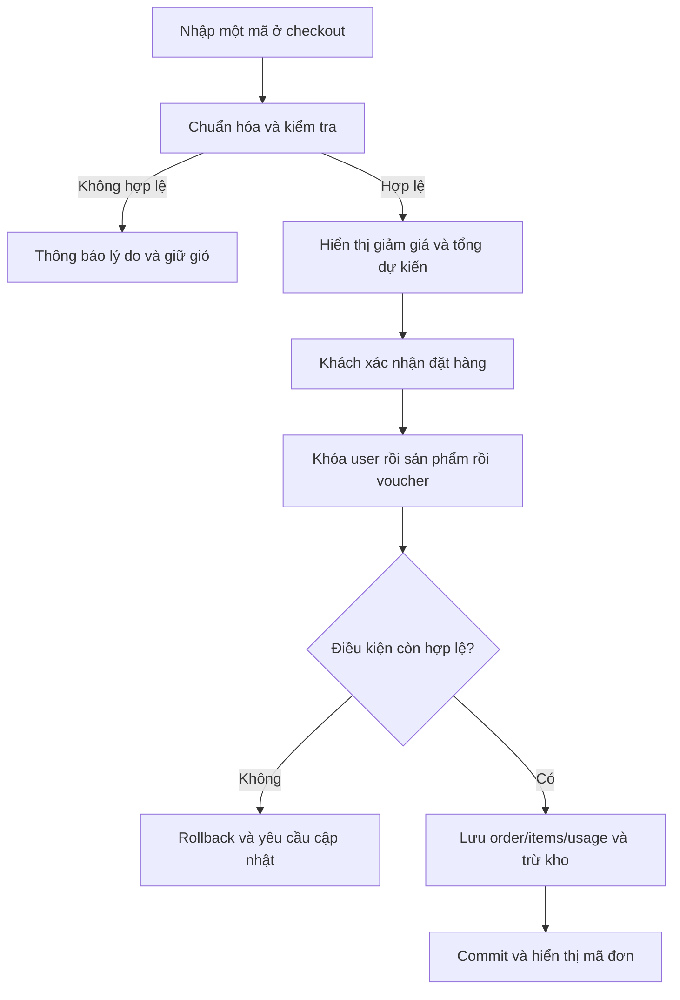

# Thiết kế bổ sung chức năng mã giảm giá

## Nhu cầu và vai trò

Khách hàng cần biết mã có dùng được không, vì sao bị từ chối và số tiền cuối cùng trước khi đặt bánh. Quản trị cần giới hạn ngân sách khuyến mãi, tránh vượt lượt khi nhiều người cùng đặt, và giữ lịch sử đối chiếu. Chức năng gắn với USER, giỏ hàng, thanh toán, đơn hàng và màn hình quản lý voucher.

## Luồng 7 bước

1. Quản trị tạo mã, loại giảm, điều kiện tiền hàng, thời hạn, tổng lượt và lượt mỗi tài khoản.
2. Khách đăng nhập, mở thanh toán, chọn địa chỉ/phương thức thanh toán, nhập một mã.
3. Bấm **Áp dụng**: server chuẩn hóa mã, kiểm tra điều kiện, tính thử mức giảm; không giữ lượt.
4. Nếu không hợp lệ, giữ dữ liệu form và hiện lý do cụ thể để khách đổi mã hoặc sửa giỏ.
5. Bấm **Xác nhận đặt hàng**: server lấy lại giá/kho, khóa mã giảm giá và kiểm tra mọi điều kiện lần nữa.
6. Hợp lệ: ghi đơn, bản chụp dữ liệu giảm giá/mã, tăng so_luot_da_dung, ghi luot_su_dung_ma cùng transaction.
7. Commit thành công: hiển thị đơn. Nếu có bất kỳ lỗi nào, hoàn tác giao dịch, không trừ kho/lượt. Hủy đơn sau đó hoàn kho nhưng không hoàn lượt voucher.



## Bảng quy tắc nghiệp vụ

| Mã | Quy tắc | Ngoại lệ/thông báo |
|---|---|---|
| V01 | Mã trim hai đầu, chuyển uppercase; 3–40 ký tự chữ/số/_/-; unique | Mã không tồn tại thì từ chối, không tự bỏ qua |
| V02 | dang_ap_dung=true; `bat_dau_luc <= now < ket_thuc_luc`, giờ Việt Nam | Chưa bắt đầu/hết hạn/ngừng dùng có thông báo riêng |
| V03 | Subtotal là tổng đơn giá hiện tại × số lượng; phải >= gia_tri_don_toi_thieu | Không tính phí giao hàng vào đơn tối thiểu |
| V04 | PERCENT: `floor(tien_hang × gia_tri_giam / 100)`, gia_tri_giam từ 1 đến 100 | Làm tròn xuống đến đồng VND |
| V05 | FIXED: giảm đúng gia_tri_giam; nếu có giam_toi_da thì áp trần | Mức giảm cuối không vượt tien_hang |
| V06 | Mỗi đơn tối đa một mã giảm giá | Không cộng gộp mã. Sản phẩm dùng giá đang bán; chưa có chương trình sale riêng |
| V07 | so_luot_da_dung < gioi_han_luot_dung; số usage của user < gioi_han_moi_nguoi | Khóa mã giảm giá và user khi ghi để tránh vượt lượt đồng thời |
| V08 | Xem trước không giữ lượt, không cập nhật cơ sở dữ liệu | Xem trước hợp lệ không đảm bảo còn lượt tại thanh toán |
| V09 | Chỉ tiêu thụ mã giảm giá khi giao dịch đặt hàng xác nhận giao dịch | Lỗi kho/địa chỉ/voucher/ghi dữ liệu thì hoàn tác giao dịch tất cả |
| V10 | Hủy đơn không hoàn lượt, kể cả hủy bởi quản trị viên | Hiển thị rõ ở thanh toán; tránh chuỗi đặt/hủy để dùng lại mã |
| V11 | Mã đã dùng không đổi ma; xóa mã đã dùng thành vô hiệu hóa | Bản chụp dữ liệu đơn cũ không đổi dù sửa giá trị mã giảm giá |
| V12 | Tổng giới hạn mới không nhỏ hơn so_luot_da_dung | Giảm per-user limit chỉ ảnh hưởng các lần dùng sau, không sửa lịch sử |
| V13 | Phí giao hàng 30.000 đ; miễn khi tien_hang >= 500.000 đ trước giảm giá | Mã giảm giá không giảm phí giao hàng |
| V14 | Tổng phải trả = tien_hang − tien_giam + phi_giao_hang | Không âm, tính bằng BigDecimal/DECIMAL |

### Ví dụ

- 1 Bánh kem dâu tây giá 320.000 đ, WELCOME10 giảm 10%, trần 50.000 đ: giảm 32.000 đ; phí giao 30.000 đ; tổng **318.000 đ**.
- 2 bánh cùng loại: tien_hang 640.000 đ; 10% là 64.000 đ nhưng trần giảm 50.000 đ; miễn ship; tổng **590.000 đ**.
- Đơn 125.000 đ nhập WELCOME10 yêu cầu tối thiểu 200.000 đ: báo chưa đủ điều kiện, không tạo đơn nếu người dùng vẫn gửi mã đó.
- Hai khách cùng dùng lượt cuối: một giao dịch xác nhận giao dịch; giao dịch sau nhận hết lượt và không bị trừ kho.

## Bản phác thảo giao diện khu vực thanh toán

```text
HOÀN TẤT ĐƠN BÁNH
┌────────────────────────────────┬──────────────────────────────────┐
│ 01 Giao bánh đến               │ ĐƠN HÀNG CỦA BẠN                 │
│ (•) Tên · SĐT                  │ Bánh kem dâu tây × 1  320.000 đ  │
│     Địa chỉ đầy đủ             │                                  │
│ + Thêm địa chỉ mới             │ Mã giảm giá                      │
│                                │ [ WELCOME10       ] [Áp dụng]    │
│ 02 Phương thức thanh toán      │ ✓ Đã tính ưu đãi / lý do lỗi     │
│ (•) COD                        │ Một mã/đơn, không cộng gộp;       │
│ ( ) Chuyển khoản               │ hủy đơn không hoàn lượt.         │
│ Hướng dẫn chuyển khoản         │                                  │
│ [Lời nhắn cho cửa hàng       ]  │ Tạm tính              320.000 đ │
│                                │ Giảm giá              −32.000 đ │
│                                │ Giao hàng              30.000 đ │
│                                │ TỔNG                  318.000 đ │
│                                │ [XÁC NHẬN ĐẶT HÀNG]             │
└────────────────────────────────┴──────────────────────────────────┘
```

Mobile xếp hai cột thành một. Form POST dùng CSRF; nhấn Áp dụng đi qua server và trả lại form đầy đủ. Nếu chưa có địa chỉ, nút đặt bị vô hiệu và có liên kết thêm địa chỉ. Mức giảm xem trước hiện là tạm tính; service quyết định lại khi tạo đơn.

## Dữ liệu, giao dịch và tích hợp

- `ma_giam_gia`: điều kiện, thời hạn, mức giảm, giới hạn và bộ đếm.
- `luot_su_dung_ma`: ghi tài khoản + mã giảm giá + đơn; giữ sau hủy. Index `(ma_giam_gia_id,nguoi_dung_id)` phục vụ giới hạn mỗi người.
- `don_hang`: `ma_uu_dai`, `tien_hang`, `tien_giam`, `phi_giao_hang`, `tong_thanh_toan` là bản chụp dữ liệu.
- `VoucherService`: chuẩn hóa, kiểm tra, tính giảm; `OrderService`: khóa, trừ kho, lưu và ghi lượt; `AdminService`: quản lý điều kiện.
- Controller thanh toán không nhận discount/total từ client. `ma_chong_dat_trung` unique và khóa tài khoản đảm bảo gửi lại cùng giao dịch không ăn thêm lượt.

## Các trường hợp nghiệm thu bắt buộc

Mã hợp lệ; mã sai; mã chưa bắt đầu; hết hạn đúng thời điểm kết thúc; bị tắt; chưa đạt gia_tri_don_toi_thieu; đạt đúng gia_tri_don_toi_thieu; hết tổng lượt; hết lượt mỗi người; trần giảm; giảm cố định lớn hơn tien_hang; hai giao dịch tranh lượt cuối; hoàn tác giao dịch khi lỗi; gửi lặp; hủy không hoàn lượt. Kiểm thử tự động và giới hạn thực tế được ghi trong `KIEM-THU.md`.
